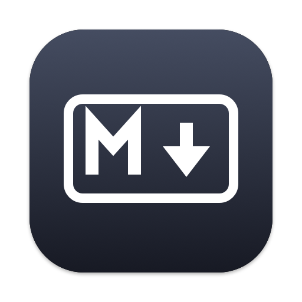
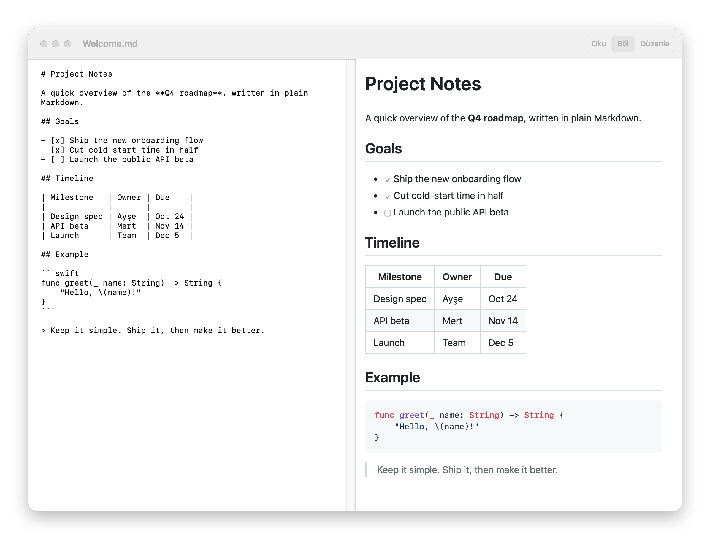

<div align="center">



# Markdown Okuyucu

**A tiny, native Markdown reader & editor for macOS.**

Read beautifully. Edit side by side. Nothing to install but the app.


</div>

---

*Okuyucu* is Turkish for "reader". Open any `.md` file and it renders like GitHub, with tables, task lists and highlighted code. Switch to Split mode to write on the left and watch the preview update live on the right.

<p align="center">
  <picture>
    <source media="(prefers-color-scheme: dark)" srcset="docs/screenshot-dark.png">
    
  </picture>
</p>

## ✨ Features

|   |   |
|---|---|
| 👁 **Three view modes** | **Oku** (Read), **Böl** (Split: edit + live preview) and **Düzenle** (Edit only). |
| 🎨 **GitHub-style rendering** | Tables, task lists and syntax-highlighted code blocks. |
| 🌗 **Light & dark** | Follows your system appearance. |
| 🪟 **Truly native** | Tabs, autosave, undo, find and full screen, like any Mac document app. |
| 🔗 **Browse docs like a wiki** | Linked `.md` files open right in the app. |
| 🖼 **Relative images** | Images load from the document's own folder. |
| 🔒 **Safe by default** | Rendered HTML is sanitized with DOMPurify, and clicked links never run local files. |

## 🚀 Getting started

**Requirements:** macOS 12 Monterey or later, and the Xcode Command Line Tools (`xcode-select --install`).

```sh
git clone https://github.com/faithere1/MarkdownOkuyucu.git
cd MarkdownOkuyucu
./build.sh
```

The app is built and installed to `~/Applications/Markdown Okuyucu.app`.

> **Make it your default:** right-click any `.md` file → **Get Info** → **Open with** → *Markdown Okuyucu* → **Change All…**

## ⌨️ Shortcuts

| Shortcut | Action |
| --- | --- |
| `⌘1` / `⌘2` / `⌘3` | Read / Split / Edit mode |
| `⌘E` | Toggle Read ↔ Edit |
| `⌘+` / `⌘-` / `⌘0` | Zoom in / out / reset |
| `⌘F` | Find |
| `⌘⇧R` | Reveal in Finder |

## 🧱 Project structure

```
main.swift        # the whole app: document, editor, preview, menus
Info.plist        # bundle settings and .md file association
Resources/
├── index.html    # preview page (render + scroll sync)
└── …             # bundled marked, DOMPurify, highlight.js, GitHub CSS
build.sh          # builds and installs the app
```

## 🙏 Built with

[marked](https://github.com/markedjs/marked) · [DOMPurify](https://github.com/cure53/DOMPurify) · [highlight.js](https://highlightjs.org) · [github-markdown-css](https://github.com/sindresorhus/github-markdown-css)

## 📄 License

[MIT](LICENSE)
